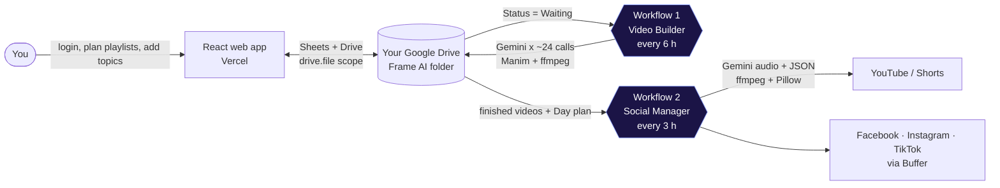
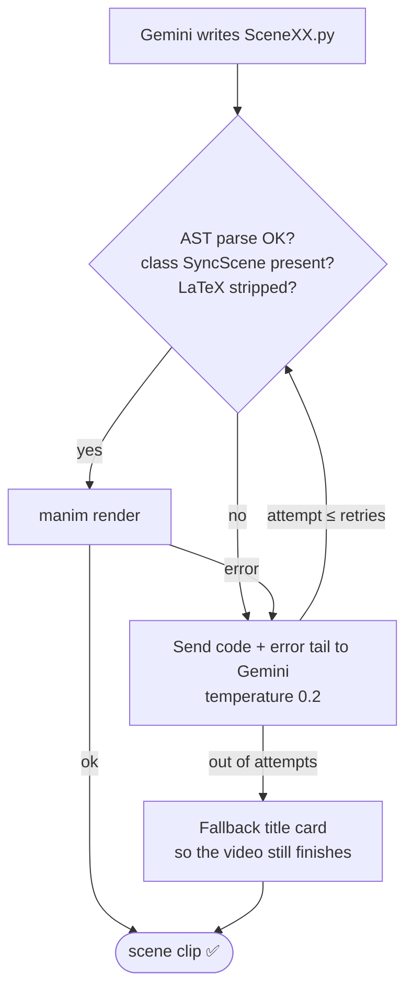
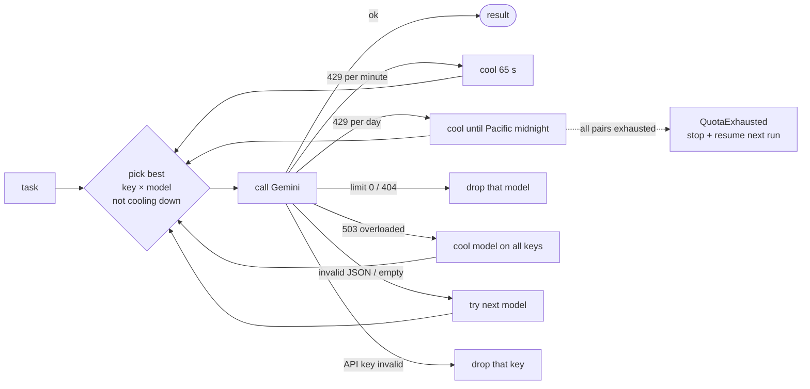

[Uploading README (4).md…]()
<div align="center">



<br/>

[](https://aistudio.google.com)
[](https://www.manim.community)
[](https://github.com/features/actions)
[](https://vitejs.dev)
[](https://python.org)
[](https://drive.google.com)
[](#-urdu-support)

### Type a topic. Gemini writes it, speaks it, animates it and posts it.

[**The problem**](#-the-problem) ·
[**How Gemini solves it**](#-how-gemini-solves-it) ·
[**Every LLM feature**](#-every-llm-feature-in-this-repo) ·
[**Workflow 1**](#-workflow-1--video-builder) ·
[**Workflow 2**](#-workflow-2--social-manager) ·
[**Run it yourself**](#-run-it-yourself-5-minutes) ·
[**Try the demo**](#-try-the-live-demo)

</div>

---

## 🎯 The problem

Making **one** good explainer video by hand is a long chain of different jobs:

| Job | Typical pain |
|---|---|
| ✍️ Write a script that teaches in the right order | Blank page, rambling, repeated ideas |
| 🎙️ Record or generate a voice | Mic, noise, re-takes, no Urdu voice |
| 🎞️ Design animations that match every spoken sentence | Hours of After Effects / Manim per minute of video |
| ✂️ Sync everything, add subtitles | Frame-by-frame editing |
| 📱 Re-cut into Shorts / Reels, write tags, hashtags, thumbnails | Another full day of work |
| 🕒 Upload on schedule to 4 platforms | Manual, easy to forget |

A creator who wants a **playlist of 30 videos** in **two languages** will never finish this by hand.
And paid video-AI tools are expensive, closed, and weak at teaching-style animation.

## 💡 How Gemini solves it

Frame AI turns each of those jobs into **a small, checkable LLM task** and chains them. The trick is not "ask one giant prompt". It is:

1. **Split the work** into many small prompts (plan → outline → write → analyze → design → code).
2. **Give every prompt the context it needs** (the plan, what was already covered, the last spoken lines, the exact audio timing).
3. **Verify the answer with normal code** (word counts, repetition detector, AST parse, real render).
4. **Feed the exact error back to the LLM** and let it repair itself.
5. **Route each task to the cheapest model that can do it**, and rotate keys/models when a free-tier quota runs out.

> Result: a free-tier-friendly pipeline where you only write a **topic** in a Google Sheet, and GitHub Actions hands you back a finished, narrated, animated `.mp4` in your Google Drive.



**No server to rent.** The web app is static + one tiny serverless function. The heavy work runs in **your own GitHub Actions**, and every file lives in **your own Google Drive**.

---

## 🧠 Every LLM feature in this repo

This is the complete map of where Gemini is used. Tier = which model list is tried first (`light` is cheap and fast, `heavy` is the most capable).

### Workflow 1 · Video Builder (`Ai-Vid-Creator/`)

| # | LLM feature | Tier | What goes in → what comes out | Where |
|---|---|---|---|---|
| 1 | **Course planner** | heavy | topic, audience, length → title, viewer goal, **one running example**, 4-10 fixed key terms, chapters with weights | `stages_gemini._make_plan` |
| 2 | **Chapter outliner** | medium | one chapter → **exactly N scenes**, each teaching one *drawable* idea (retried if the count is short) | `_make_outline` |
| 3 | **Narration writer** | heavy | scene batch + brief + "already covered" list + last 2 spoken sentences → natural spoken script | `_write_batch` |
| 4 | **Self-critic loop** | heavy | code detects: too short/long, no end punctuation, >30 % repeated 5-word phrases → LLM rewrites with the **named problem** | `_problems` + rewrite |
| 5 | **Own-script mode** | light | your finished script is used **word for word**; LLM only adds 2-5 word scene headings | `script_input._headings` |
| 6 | **Text-to-speech** | TTS | narration + voice + "tone of delivery" → WAV. 30 prebuilt voices, style prompts, 4 scenes per call, cut at verified silences | `tts.TTS` |
| 7 | **Concept analyzer** | light | scenes → concepts, examples, key points, **4-7 typed visuals** (graph, flowchart, analogy, counter, before/after …) | `stage_analyze` |
| 8 | **Motion designer** | medium | scene + real sentence timings → animation steps **pinned to sentence indexes** (3Blue1Brown style) | `stage_spec` |
| 9 | **Manim programmer** | heavy | spec + strict API rules → a complete `SceneXX(SyncScene)` Python file | `render_scene` |
| 10 | **Auto-repair debugger** | heavy | broken code + the last 3 000 chars of the Manim error → fixed code (temperature 0.2, up to `retries`) | `render_scene` |
| 11 | **Language-aware prompting** | all | Urdu: Urdu script, `۔ ؟` punctuation, English terms written in Urdu script, no LaTeX, RTL font; narration and on-screen language can differ | `narration_rules`, `screen_rules`, `manim_rules` |

### Workflow 2 · Social Manager (`Social-Manager/`)

| # | LLM feature | Tier | What goes in → what comes out | Where |
|---|---|---|---|---|
| 12 | **Gemini transcription** (listens to audio) | medium | MP3 of the video → timed subtitle lines (≤90 chars, end at pauses). Used only if no `.srt` and no script exist | `social_ai.transcribe` |
| 13 | **Smart reel planner** | medium | timed transcript + real pause points → N reels, each a complete idea, with a **hook line**; result is *validated and snapped* to real silences | `plan_reels_ai` |
| 14 | **SEO writer** | light | video title + what is said → 10-14 search tags, 5-8 hashtags, one hook (≤90 chars). **One call serves every platform** | `enrich` |
| 15 | **Graceful AI** | - | every call is wrapped in `_safe()`: if Gemini fails, the upload continues with the text from the web app | `_safe` |

### Shared brain (both workflows)

| # | Feature | What it does |
|---|---|---|
| 16 | **Model tiers** | `heavy / medium / light` model lists per task; fallback order between tiers |
| 17 | **Key + model rotator** | many API keys × many models, per-pair cooldown, error classification (rate / overloaded / bad output / bad key / bad model) |
| 18 | **Adaptive thinking** | heavy = full thinking, medium = low, light = minimal / budget 0 |
| 19 | **JSON mode + fence stripping** | strict JSON answers, markdown fences removed, bare list vs `{"scenes": []}` tolerated |
| 20 | **Quota-aware resume** | daily quota wall → run stops cleanly, row goes back to `Waiting`, cache keeps finished stages |
| 21 | **Voice preview in the browser** | the web app calls Gemini TTS directly with your key so you can *hear* a voice before choosing it |

---

## 🎬 Workflow 1 · Video Builder

<div align="center">

</div>

**File:** `.github/workflows/frame-ai.yml` · **Runs:** every 6 hours + manual button · **Needs:** `GOOGLE_REFRESH_TOKEN`, `GOOGLE_CLIENT_SECRET`

### What you do

You add a row to your playlist sheet in the web app:

| Video Title | Topic / Prompt | Minutes | Language | Screen Language | Voice | Status |
|---|---|---|---|---|---|---|
| Gradient Descent in 3 Minutes | How does gradient descent work? | 3 | Urdu | English | Kore | **Waiting** |

### What the workflow does (example, trimmed and illustrative)

<details open>
<summary><b>① Script - plan → outline → write → check</b></summary>

For a 3-minute video the code computes: `12 scenes × ~37 words`, 1 chapter (videos over 4 min get 1 chapter per ~2 min).

**Plan call (heavy, temperature 0.7)** returns:
```json
{
  "title": "Gradient Descent: Walking Downhill in the Fog",
  "goal": "Viewer can explain why a model nudges its weights step by step",
  "running_example": "A hiker in thick fog feeling the slope under their feet",
  "terms": [
    {"term": "loss", "meaning": "how wrong the model is right now"},
    {"term": "learning rate", "meaning": "how big each step is"}
  ],
  "chapters": [{"title": "Downhill in the fog", "weight": 3}]
}
```
That **running example** and the **fixed terms** are pasted into every later prompt, so scene 11 still talks about the same hiker as scene 1.

**Write call (heavy)** gets the brief, a list of what is *already covered*, and the last two spoken sentences, so it continues the story and never says "welcome" twice.

**Check (plain Python, no LLM):**
```
scene 5: too short (14 words; write about 37)
scene 7: repeats wording from earlier scenes - say it differently or move on
→ rewrite only those scenes, tell the model the exact problem, keep the better version
```
</details>

<details>
<summary><b>② Voice - Gemini TTS with a verified timeline</b></summary>

* Narration is sent to Gemini TTS (`gemini-3.8-flash-tts` first, older TTS models as fallback, Google Cloud TTS as a last reserve).
* Up to **4 scenes per call** to save quota. The audio is then **cut at real silences**; if a cut does not land inside a true pause, the whole group is thrown away and redone scene by scene.
* `ffmpeg silencedetect` + sentence length give a **per-sentence timeline**: `{"i": 3, "start": 7.41, "end": 11.02}`.
* The delivery is controlled by a plain-English style, e.g. *"calm, clear and friendly, like a good teacher"*.
</details>

<details>
<summary><b>③ Analyze - what should the viewer SEE?</b></summary>

Light model, 5 scenes per call. For every scene it returns concepts, examples, key points and **4-7 visuals** chosen from 20 types:
`text, equation, graph, number_line, diagram, flowchart, shapes, table, comparison, process, timeline, analogy, data_flow, zoom_in, before_after, counter, worked_example, network, grid, stack`.

```json
{"id": 4, "visuals": [
  {"type": "graph",   "description": "bowl-shaped loss curve, a dot rolling down it"},
  {"type": "counter", "description": "loss value counting down 9.0 → 0.4"}
]}
```
</details>

<details>
<summary><b>④ Motion spec - every animation is pinned to a spoken sentence</b></summary>

The model is told to act like an award-winning motion designer. Rules it must follow: at least 2 steps per sentence, 2-4 phases per scene, entrances with direction, staggered arrivals, travelling dots on arrows, nothing static for more than ~2 s.

```json
{"sentence": 2, "phase": 1, "action": "flow",
 "object": "blue dot travelling along the curve into the valley",
 "text": "step", "position": "center"}
```
`pin_steps()` then converts `sentence: 2` into an **absolute second from the real audio** (`at_sec: 7.46`) and a `max_run` time. The LLM never guesses timestamps.
</details>

<details>
<summary><b>⑤ Manim code - the LLM is the animator, and it fixes its own bugs</b></summary>


The prompt contains a **strict rulebook** (allowed Manim API, no LaTeX/external files, 16:9 safe area, easing functions, shadows/glow, idle motion, one colour per concept from a fixed palette). The model must call `self.at(<second>)` before each step, so the animation lands on the spoken word.
</details>

<details>
<summary><b>⑥ Sync + deliver</b></summary>

`ffmpeg` freezes the last frame if the animation is shorter than the voice (or pads silence if longer), concatenates all scenes, writes a `.srt`, then the MP4 is uploaded to `<playlist>/Output/` in Drive and the sheet row becomes **Completed** with the **Output Link**.
</details>

### 📊 How many Gemini calls is that?

| Video length | Scenes | Chapters | Text calls (plan + outline + write + analyze + spec + code) | Speech calls |
|---|---|---|---|---|
| 3 min | 12 | 1 | 1 + 1 + 3 + 3 + 4 + 12 = **24** | 3 |
| 10 min | 40 | 5 | 1 + 5 + 10 + 8 + 14 + 40 = **78** | 10 |

*(plus repair calls only when a scene fails to render)*

### Row life-cycle

`Waiting` → `In Process` → `Completed` → (`Uploaded` by Workflow 2) · or `Failed` with the error in **Notes**.
A cancelled run leaves `In Process [gh-action]`; the next run picks it up again.

---

## 📲 Workflow 2 · Social Manager

<div align="center">

</div>

**File:** `.github/workflows/social-upload.yml` · **Runs:** every 3 hours + manual button · **Needs:** `GOOGLE_REFRESH_TOKEN`, `GOOGLE_CLIENT_SECRET`, `GOOGLE_CLIENT_ID`

### What you do

In the **Social** tab you pick finished videos, choose a **day**, choose where they go (YouTube complete video, YouTube Shorts, Facebook, Reels …) and how each video is cut. The web app writes one file per day: `Frame AI / Social / Days / 2026-10-15.json`. **You pick the day, the backend picks the time** (slots between 10:00 and 22:00 in your timezone).

### What the workflow does (example, illustrative)

**1. Subtitles - three sources, cheapest first**

```
1) an .srt file next to the video in Drive      → free
2) your script text aligned to real pauses      → free
3) Gemini listens to the audio                  → 1 LLM call  ← only if 1 and 2 are missing
```

**2. Reel planning - "Let the backend choose"**

Gemini gets the timed transcript, the target (e.g. 4 reels ≈ 45 s each) and the list of real pause points, then must return reels that start and end on sentence boundaries:

```json
{"reels": [
  {"start": 0.0,  "end": 44.6, "hook": "Imagine walking downhill blindfolded"},
  {"start": 44.6, "end": 91.2, "hook": "Why a tiny step beats a giant leap"}
]}
```
Then **plain code double-checks the LLM**: cuts are snapped to the nearest true silence (within 4 s), overlaps removed, tiny reels dropped, and if the result looks wrong (wrong count, covers < 60 % of the video) it silently falls back to chapter-based cuts.

**3. Brand + thumbnail (no LLM)**

Logo, lower-third, intro, outro and end card with `ffmpeg`; 1280×720 thumbnail with `Pillow`, with Urdu text correctly shaped right-to-left.

**4. SEO metadata - one call for every platform**

```json
{"tags": ["gradient descent", "machine learning basics", "گریڈینٹ ڈیسنٹ", "..."],
 "hashtags": ["#GradientDescent", "#MachineLearning", "#AIUrdu", "..."],
 "hook": "How a model learns by walking downhill"}
```
Bilingual tags (English + Urdu) are requested automatically when the video is not English. Results are cached per reel part, so a retry never re-spends quota.

**5. Publish**

| Platform | Via | Notes |
|---|---|---|
| YouTube + Shorts | YouTube Data API v3 | resumable upload, `thumbnails.set`, `captions.insert` |
| Facebook, Instagram, TikTok | Buffer GraphQL API | Drive file is made public for ≤3 h so Buffer can fetch it, then revoked |

YouTube cost model used by the runner: upload **1 600** units, thumbnail **50**, captions **400** of a default **10 000**/day, i.e. about **6 videos a day**. If a platform says "quota", only that platform is paused and the rest continue.

### Manual run options

| Input | Meaning |
|---|---|
| `ignore_time` | Upload today's planned items **now**, do not wait for their time slot |
| `dry_run` | Only print what is **due**, upload nothing |

---

## ⚙️ Model routing & resilience

Each task is mapped to a tier and gets a **fallback chain** (the cheap tier is never used for the quality-critical `plan` and `write` tasks):

| Task | Tier | Chain order | Why |
|---|---|---|---|
| plan, write, code, repair | heavy | heavy → medium → light | quality sets the whole video |
| outline, spec, reel planning, transcription | medium | medium → light → heavy | structure, low thinking is enough |
| analyze, tags, headings | light | light → medium → heavy | tiny JSON, huge free allowance |



Free-tier extras: Flash-Lite models get **3× the request rate**, several keys from *different* Google Cloud projects multiply your daily allowance, and all keys are masked in the Actions log.

**Everything is cached**: script parts, audio per scene, analysis, spec and rendered clips are saved after every step, and the Actions cache keeps TTS audio and saved scripts between runs.

---

## 🖥️ The web app (frontend)

| Tab | What it is for |
|---|---|
| **Playlists / Singles** | Each playlist = a Drive folder + a sheet of videos + its own narrator, thumbnail style and defaults |
| **Narrator** | Hear 30 Gemini voices with your own key, set the tone of delivery |
| **Thumbnails** | Template + title text styling, saved per playlist |
| **Production** | Order of playlists and videos per turn for the backend |
| **Social** | Calendar planner: pick day, order, reel cutting, platform captions |
| **Brand** | One logo / colours / intro / outro for every video |
| **Control room** | Gemini keys, model lists per tier, rate limits, **Connect backend** (refresh token) |

Settings merge in three layers: **global** `frame_config.json` < **playlist** `project_config.json` < **one video row**.
The app only touches files it creates (`drive.file` scope).

---

## 🚀 Run it yourself (5 minutes)

You need: a Google account, a GitHub account, and one free [Gemini API key](https://aistudio.google.com/apikey).

### Step 1 · Open the frontend and create your refresh token

1. Open the deployed web app: **`[https://YOUR-FRONTEND-URL](https://frame-ebon-three.vercel.app/)`**
2. Click **Connect Google Drive** and log in with Google.
3. Go to **Control room**:
   * paste your **Gemini API key(s)**, one per line, and save (they are stored in *your* Drive, not in GitHub)
   * under **Backend connection** click **Connect backend** → **Copy token**.

> ⚠️ The token is shown once. Treat it like a password.

### Step 2 · Get the code into your own repository

```bash
git clone https://github.com/salalshabbir472/Frame-Ai.git
cd Frame-Ai
# create an empty repo on GitHub first, then:
git remote set-url origin https://github.com/<you>/<your-repo>.git
git push -u origin main
```

GitHub only runs workflows that sit in **`.github/workflows/`** at the root of the repository.

### Step 3 · Add the GitHub secrets

`Settings` → `Secrets and variables` → `Actions` → **Secrets** tab → **New repository secret**

| # | Name | Value |
|---|---|---|
| 1 | `GOOGLE_REFRESH_TOKEN` | the token you copied in Step 1 (starts with `1//`) |
| 2 | `GOOGLE_CLIENT_SECRET` | the OAuth client secret of the Google project (ask the project owner, never commit it) |
| 3 | `GOOGLE_CLIENT_ID` | `889548932794-omd87pjp862sei42pe9evfibttmnqnl7.apps.googleusercontent.com` *(public value, also used by the frontend)* |

> Workflow 1 has the client ID built in and needs only secrets **1 and 2**. Workflow 2 reads secret 3 as well, so add all three.

### Step 4 · Run both workflows manually (test)

1. Open the **Actions** tab (click *"I understand my workflows, enable them"* if asked).
2. **Video Builder:** in the web app add one short video (1 minute) with **Status = Waiting**, then
   `Actions` → **Frame AI - build waiting videos** → **Run workflow** → green button.
   Open the run to watch the stages; the finished MP4 appears in `Frame AI / <playlist> / Output` and the sheet row turns **Completed**.
3. **Social Manager:** in the **Social** tab plan the finished video for **today**, then
   `Actions` → **Frame AI - Social upload** → **Run workflow**.
   First tick **`dry_run`** to see what is due, then run again with **`ignore_time`** to upload immediately.

After that both run on their own schedule (video every 6 h, social every 3 h).

---

## 🧪 Try the live demo

> ### 📧 Want to test the app?
> The Google Cloud project is currently in **Testing mode**, so Google only lets **approved test users** sign in.
> **Send me your Google (Gmail) address at `<YOUR_EMAIL_HERE>`** and I will add you as a test user. After that you can log in to the demo and run the whole flow above.

Testing-mode notes:

* Google **expires refresh tokens after 7 days** while the consent screen is in *Testing*. If a workflow stops with *"Google refused the refresh token"*, generate a new token in **Control room → Connect backend** and update the `GOOGLE_REFRESH_TOKEN` secret. Publishing the OAuth app removes this weekly chore.
* If login says *"Access blocked: app has not completed verification"*, your email is not on the test-user list yet.

---

## 🌍 Urdu support

* Narration language and on-screen language are **independent** (e.g. Urdu voice + English labels).
* Urdu prompts force **Urdu script** (never Roman Urdu), `۔` and `؟`, small numbers as words, and English technical terms written in Urdu letters so the voice reads them properly.
* On-screen Urdu uses **Noto Naskh Arabic** (installed by the workflow), no LaTeX.
* Thumbnails shape Urdu text correctly with `arabic-reshaper` + `python-bidi`.
* Heads-up from the code: Urdu is not in Google's official Gemini-TTS language list, so Gemini may still speak it but listen first (voice preview in the Narrator tab); Google Cloud TTS (`ur-IN`) is available as a fallback engine.

---

## 🛠️ Troubleshooting

| Message | Fix |
|---|---|
| `Missing: GOOGLE_CLIENT_SECRET, GOOGLE_REFRESH_TOKEN` | Add the secrets in Step 3 (names are case-sensitive) |
| `Google refused the refresh token` | Make a new token in Control room and replace the secret (see Testing-mode note) |
| `Folder 'Frame AI' not visible` | The token belongs to a different Google account than the one used in the web app |
| `frame_config.json not found` | Open the web app → Control room → **Save** once |
| `keys.gemini is empty` | Paste at least one Gemini key in the Control room |
| `every key/model is rate-limited ... (daily quota?)` | Normal on the free tier. The row returns to **Waiting** and resumes next run; add keys from other Google projects to get more |
| Urdu on screen shows boxes | Install an Urdu font on the runner (`fonts-noto-core` is already in the workflow) |
| Nothing is uploaded by Workflow 2 | Check that something is planned for **today** in your timezone, or run with `ignore_time` |

---

## 🗂️ Repository map

```
Frame-AI/
├─ src/                    React app (Landing, Playlists, Narrator, Social, Brand, Control room)
│  ├─ drive.js             Google sign-in, Drive + Sheets access, refresh-token code flow
│  ├─ config.js            every setting once: defaults, 30 voices, 3 config layers
│  └─ socialPlan.js        planner rules for days, reels and platforms
├─ api/exchange.js         Vercel function: one-time code → refresh token (client secret stays server-side)
├─ Ai-Vid-Creator/         ── Workflow 1 ──
│  ├─ drive_runner.py      reads Drive + Sheets, builds waiting rows, uploads results
│  ├─ pipeline.py          the 6 stages + CLI
│  ├─ stages_gemini.py     every Gemini prompt (plan, outline, write, analyze, spec, code, repair)
│  ├─ gemini_client.py     tiers, Rotator, error classifier, thinking budgets
│  ├─ tts.py               Gemini TTS + Cloud TTS fallback, grouped calls, caching
│  ├─ script_input.py      "use my own script" mode
│  ├─ media.py             silence timeline, Manim render, ffmpeg sync, SRT
│  ├─ sfx.py               procedural sound-effects engine (opt-in, not in the default run)
│  └─ .github/workflows/frame-ai.yml
└─ Social-Manager/         ── Workflow 2 ──
   ├─ social_runner.py     daily plan → due items → process → status back
   ├─ social_ai.py         transcription, reel planner, SEO tags
   ├─ social_media.py      branding, reel cutting, subtitle alignment
   ├─ social_thumb.py      thumbnail composer
   ├─ social_platforms.py  YouTube API + Buffer
   └─ social-upload.yml
```

## 🧰 Tech stack

**LLM:** Google Gemini (text, JSON mode, audio input, TTS) · **Animation:** Manim Community · **Media:** ffmpeg, Pillow · **Backend:** Python 3.11 on GitHub Actions · **Frontend:** React 18 + Vite · **Storage / DB:** Google Drive + Google Sheets · **Publishing:** YouTube Data API v3, Buffer

## 🔐 Security notes

* Never commit the client secret, refresh token or API keys. Use **GitHub Secrets** only.
* Gemini keys live in `Frame AI / Application Config / frame_config.json` in *your* Drive. Keep that folder private.
* `Social / social_config.json` holds platform logins. Keep the `Social` folder private too.
* The frontend only requests the `drive.file` scope: it can see only the files Frame AI created.
* If a token or secret was ever pasted somewhere public, revoke it at [myaccount.google.com/permissions](https://myaccount.google.com/permissions) and create a new one.

---

<div align="center">

**Frame AI** · built with Gemini, Manim and a lot of ffmpeg ❤️

*Plan a playlist. Frame builds the videos.*

</div>
